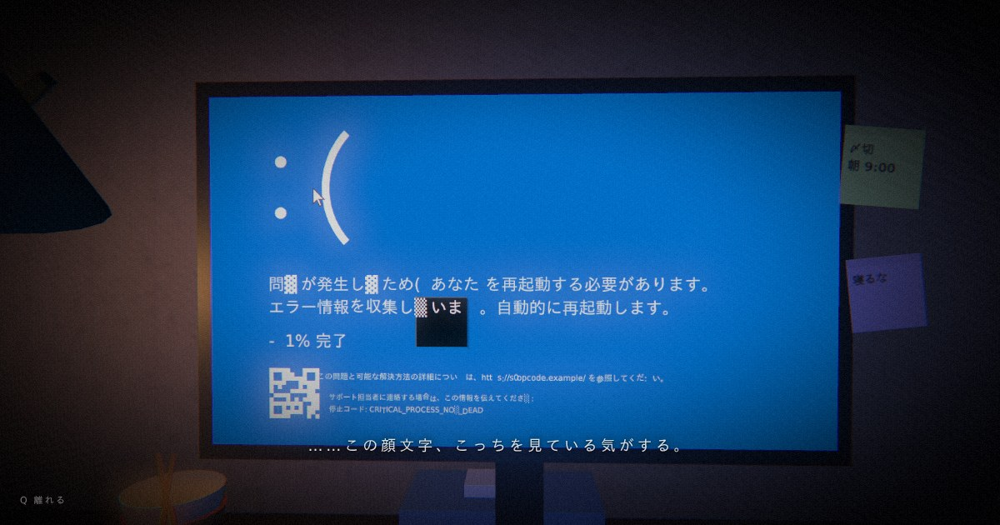

# 0% 完了 :(

午前2時47分。締め切り前夜の自室で、PCが青く止まる。
ブラウザで遊べる、一人称視点の短編グリッチホラー（約5分・ヘッドホン推奨）。

**▶ 公開版: https://bsod-fable.vercel.app/**



> ※ 激しい点滅・画面の揺れ・大きな音を含みます。タイトル画面の「点滅と揺れを弱める」で軽減できます。
> キーボードとマウスで操作する PC ブラウザ向けの作品です。

## 操作

| キー | 動作 |
| --- | --- |
| `W` `A` `S` `D` | 移動（`Shift` で走る） |
| マウス | 視点（ポインターロック不可の環境ではドラッグ／矢印キー） |
| `E` / クリック | 調べる・触れる |
| `Q` | モニターから離れる |
| `C` | コンソール（ある場所でだけ開く） |
| `M` | ミュート |
| `R` | 最初からやり直す（エンディング後） |

## 開発

```bash
npm install
npm run dev        # http://localhost:5173
npm run build      # 型チェック + dist/ へ本番ビルド
npm run preview    # ビルド結果を確認
```

URL に `?debug` を付けると `window.__engine` が公開され、
`__engine.debugGo('bsod' | 'devour' | 'world' | 'tower' | 'collapse')` で各場面へ飛べます。

## 構成

画像・音声などの外部アセットは一切なく、テクスチャは Canvas 2D、音は Web Audio、
絵は three.js + 自前シェーダーですべて実行時に生成しています。

```
index.html            エントリ HTML（OGP・favicon）
src/
  main.tsx            React のマウント
  App.tsx             タイトル・字幕・操作ヒント・ゲーム内コンソールなどの UI
  index.css           Tailwind CSS v4 + 少量の独自スタイル
  game/
    Engine.ts         進行管理（title → room → monitor → devour → world → collapse → after）、入力、メインループ
    room.ts           自室（机・モニター・小物・照明・時計・残骸）と Portal シェーダ。glTF で読み込んだ寝室の箱と小物を束ねる
    bedroom.ts        寝室シーン（壁・床・天井・窓・ベッド・机・PC・椅子・ランプ・外の雨・ひび・塵）の構築と、それ用のマテリアル
    bsodScreen.ts     モニターに映る画面（デスクトップ → フリーズ → ブルースクリーン）
    devour.ts         画面に呑まれる演出
    world.ts          ブルースクリーンの内側の世界
    collapse.ts       世界の崩壊 〜 落下 〜 目覚め
    post.ts           ポストプロセス（ブルーム・色収差・グリッチ・粒子ノイズ等）
    audio.ts          Web Audio による環境音・効果音の合成
    textures.ts       Canvas 2D によるテクスチャ生成
    utils.ts          数学ユーティリティ（ノイズ・補間・バネ等）
public/
  favicon.svg, og.jpg
  models/           寝室・ゲーミングPC・椅子・ケーブルの glTF（CC-BY、下記クレジット参照）
  textures/         壁紙・床・ラグの法線/拡散、置時計・ランプ、およびベッド上の絵（パブリックドメイン）
```

## クレジット

寝室を形作る 3D モデルは Sketchfab で公開されている作者の方々の CC-BY 4.0 作品をお借りしています（改変・再配布）。ライセンスに従い作者名とリンクを明記します。

- **Modern Stylized Bedroom** — Visthétique, https://sketchfab.com/3d-models/modern-stylized-bedroom-b74c53589e334ba1ba4b43883d7c9e21
- **Gaming Desktop PC** — Yolala1232, https://sketchfab.com/3d-models/gaming-desktop-pc-d1d8282c9916438091f11aeb28787b66
- **Office Chair** — crow (crow.bite), https://sketchfab.com/3d-models/office-chair-5cd859cd7b9a430db0195af2ba89949b
- **Modular cables 1m** — Sim387 (350rdlc.sl), https://sketchfab.com/3d-models/modular-cables-1m-86fd2a4c57144bf083882564a63870f7

壁・床・ラグの表面テクスチャ、およびベッド上の絵（Henry Fuseli 『夢魔』1781）はパブリックドメインの素材を元にしています。

## 技術

Vite 8 / React 19 / TypeScript / Tailwind CSS v4 / three.js — Vercel にデプロイ（`vercel.json`）。
